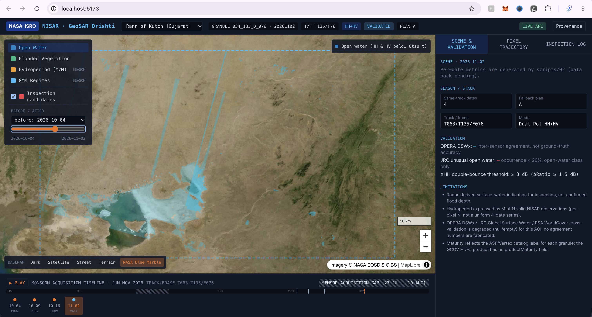

<!--
  Handbook Section 6 — Mandatory README structure (6 sections):
  1. Project Title & Problem Statement
  2. Team Details
  3. Solution Overview & Architecture
  4. Live Demo & Screenshots
  5. Installation & Setup Guide
  6. AI Usage Disclosure
  Live deployment URL MUST sit at the very top (Handbook Section 4).
-->

# 🛰️ Live Demo: _TBD — paste hosted URL here before the 2:00 PM, 15 Nov 2026 code freeze_

> Frontend (GitHub Pages / Vercel / Netlify): `https://…`
> Backend API health check: `https://…/api/v1/health`

---

# 1. Project Title & Problem Statement

## GeoSAR Drishti — *The Monsoon Dance of Water*

**NASA Space Apps Challenge 2026 · Nagpur (WCEM) · CH-06 "Dancing with the SARs"**

**Problem.** During the monsoon, floodplain managers cannot see where water spreads, how long it stays, or where it hides beneath vegetation — clouds blind optical satellites exactly when inundation peaks, and standard flood maps show only *open* water.

**What we built.** An interactive NASA–ISRO NISAR L-band ($24\,\text{cm}$) radar time-series console that reveals, across a whole monsoon season:

- **Open water vs. canopy-hidden water** — specular dark open water vs. L-band double-bounce flooded vegetation (`ΔHH ≥ +3 dB`).
- **Monsoon hydroperiod** — "wet in **M of N** valid NISAR observations" (never "days flooded").
- **Normal vs. unusual** — radar open water vs. JRC historical occurrence + OPERA DSWx inter-sensor agreement.
- **Repeatedly wet roads & settlements** — OSM exposure log of ground-inspection candidates.
- **Plain-language radar evidence cards** — grounded strictly on computed numbers.

> **Honest framing.** Every result is a *radar-derived surface/canopy-water indication for field inspection* — not a confirmed flood, depth, or damage claim. Agreement with OPERA is *inter-sensor agreement*, not ground-truth accuracy.

---

# 2. Team Details

**Team name:** Cosmos InfoVerse Techky · **Org:** InfoVerse Cosmos / InfoVerse Tech Services

| # | Full Name | GitHub Username | Home Institution | Role |
| :- | :-- | :-- | :-- | :-- |
| 1 | Pravin Tawade | `@cosmosinfoverse` | _[institution]_ | Team Owner — architecture, L-band SAR physics, mission lead |
| 2 | kaushik zade | `@kaushik7` | _[institution]_ | FastAPI backend, NASA `earthaccess` connector, offline raster processing |
| 3 | Sharv Dalal | `@shardstax` | _[institution]_ | Telemetry UI (React/MapLibre), monsoon time slider |
| 4 | Himanshu Sharma | `@lunar_node` | _[institution]_ | NISAR L2 GCOV data gate, PROVISIONAL/VALIDATED calibration, OPERA/JRC validation |
| 5 | Sakshi Manav Tayade | `@sakshitayade` | _[institution]_ | GMM regime clustering, ESA WorldCover, OSM exposure, Nagpur context |
| 6 | Prashan Arya | `@prashan_arya` | _[institution]_ | Evidence-card service, error/fallback QA, hourly Git compliance |

> **Team size:** Our 6-member roster is approved — the NASA Space Apps portal permits it and the Nagpur organisers confirmed our registration. Fill in each member's home institution. Every member must appear in **GitHub → Insights → Contributors** with commits from their **own** account (Section 4).

---

# 3. Solution Overview & Architecture

Two-tier hybrid client–server platform (true client–server separation, cloud-deployable, graceful offline fallbacks).

```text
apps/web (Vite + React 18 JS/JSX + MapLibre GL JS + Tailwind)
      │  HTTPS REST JSON + RGBA PNG overlays (CORS)
      ▼
services/api (Python 3.11 + FastAPI + Uvicorn + Rasterio + NumPy + earthaccess)
      ├─ Live connectors: NASA Earthdata CMR / ASF, optional LLM narrator (strict timeouts)
      └─ Local pre-computed AOI packs: COG/RGBA-PNG overlays, time_series_cube.npz, GeoJSON
```

**Two pre-configured AOIs:** Majuli–Kaziranga (Assam, primary) · Kanhan–Pench (Nagpur, regional pilot). A third full pack, Rann of Kutch (Gujarat), renders end-to-end from four real NISAR GCOV granules.

**Two audiences, one console.** A top-bar **Simple / Scientist** toggle switches the whole experience:

- **Simple (default)** — satellite backdrop, plain result layers (*Open water*, *Water hidden under plants*, *Repeatedly wet areas*), a one-line plain "what happened here" on map click, and a **one-click Analysis Report** — no dB, Otsu thresholds, or granule/track jargon.
- **Scientist** — the full telemetry console unchanged (per-scene Otsu/ΔHH thresholds, dB trajectories, granule/track-frame/polarization/maturity pills, provenance).

The **Analysis Report** (📊 button, either mode) summarises the current AOI in plain language — where water was, hydroperiod (M of N), what changed between passes (computed *within* a single track, since NISAR images an AOI from more than one track), which roads/settlements are inspection candidates — grounded strictly in computed numbers, with the honest caveat and a provenance footer (granules, dates, thresholds).

**Scientific pipeline (100% deterministic math):** γ⁰ HH/HV subset → validity + DEM-slope masks → speckle filter + dB conversion (`Ratio_dB = HH_dB − HV_dB`) → per-date 3-class classifier (Otsu open water, ΔHH double-bounce flooded vegetation, dry) → M-of-N hydroperiod → unsupervised GMM regimes → OPERA DSWx / JRC validation → OSM exposure.

**Tech stack**

| Layer | Technology |
| :-- | :-- |
| Frontend | React 18 (JS/JSX), Vite, MapLibre GL JS, Tailwind CSS, Recharts, Zustand |
| Backend | FastAPI, Uvicorn, Rasterio, NumPy, httpx, earthaccess |
| Processing | scikit-learn (GMM), scikit-image (Otsu), h5py, geopandas, osmnx, Pillow |
| Data | NASA–ISRO NISAR L2 GCOV, OPERA DSWx-S1/NI, EC JRC GSW, ESA WorldCover, OSM, GSDA/CGWB |
| Hosting | GitHub Pages / Vercel / Netlify (web) · Render / Railway / Cloud Run (API) |

Full design: [`Docs/geosar_intelligence_srs_and_implementation_blueprint.md`](Docs/geosar_intelligence_srs_and_implementation_blueprint.md) · build plan: [`Docs/IMPLEMENTATION_PLAN.md`](Docs/IMPLEMENTATION_PLAN.md).

---

# 4. Live Demo & Screenshots

- **Live app:** _TBD_ (also pinned at the top of this README)
- **Demo video:** _TBD (optional)_
- **Screenshots:** stored in `assets/screenshots/` (tracked in-repo)



```text
[ Top mission bar: NISAR · dual-AOI selector · granule/track/pol/maturity pills · LIVE API / LOCAL CACHE ]
[ Center MapLibre viewport: SAR layers, AOI boundary, click-to-inspect ]
[ Bottom monsoon time slider: acquisition ticks + 27 Jul–10 Aug gap band ]
[ Right drawer: scene metrics · pixel dB trajectory + evidence card · OSM inspection log ]
```

---

# 5. Installation & Setup Guide

**Prerequisites:** Python 3.11 (SRS target), Node 18+, git.

### Fastest: one command runs both tiers
```bash
git clone https://github.com/InfoVerse-Cosmos/ICT-GeoSARDrishti.git
cd ICT-GeoSARDrishti

# macOS / Linux
./run.sh            # or: npm run dev
# Windows
run.bat
```
Either script installs deps on first run, starts FastAPI (:8000) + Vite (:5173), wires the
frontend to the backend, and opens both. Skip installs on a fast restart with
`./run.sh --no-install` (or `run.bat --no-install`).

- API → http://localhost:8000/docs
- UI → http://localhost:5173

On macOS/Linux `run.sh` runs both in one terminal (Ctrl-C stops both); on Windows `run.bat`
opens two windows (close them to stop). The backend boots in deterministic local-cache mode
with **no** token required.

### Or run each tier manually
```bash
# Backend (FastAPI)
cd services/api
python3 -m venv .venv && source .venv/bin/activate
pip install -r requirements.txt
cp ../../.env.example .env          # optionally set EARTHDATA_TOKEN / LLM_API_KEY
uvicorn app.main:app --reload --port 8000

# Frontend (Vite + React) — new terminal
cd apps/web
npm install
echo "VITE_API_BASE_URL=http://localhost:8000" > .env
npm run dev
```

**Deploy.** API: `uvicorn app.main:app --host 0.0.0.0 --port ${PORT:-8000}` on Render/Railway/Cloud Run (set `EARTHDATA_TOKEN`, `CORS_ORIGINS`, optional `LLM_API_KEY`). Web: build `apps/web` (`npm run build`, output `dist`) on GitHub Pages / Vercel / Netlify with `VITE_API_BASE_URL` pointed at the API.

### Bring your own AOI (analyse your own NISAR data)

Clone the repo and build a data pack for **your own area** from **your own** NISAR L2 GCOV granules, with one command that wraps the same pipeline (`scripts/geosar_pipeline`) that produced the shipped packs.

**1. Install the offline-processing dependencies** (heavier than the API runtime):
```bash
pip install -r scripts/requirements.txt   # numpy, h5py, pyproj (+ scikit-learn, rasterio, geopandas, osmnx)
```

**2. Get NISAR L2 GCOV granules** for your area and monsoon window — download `.h5` files from [NASA Earthdata Search](https://search.earthdata.nasa.gov/) / ASF DAAC (collections `NISAR_L2_GCOV_PROVISIONAL_V1`, `NISAR_L2_GCOV_V1`) into one folder. Granules are large and are **never** committed (`.gitignore` excludes `*.h5`).

**3. Build the pack** — pass an AOI id, a name, the bounding box (`west,south,east,north` WGS84), and the granule folder:
```bash
python scripts/byod_build_aoi.py \
    --aoi-id aoi_my_delta --name "My River Delta" \
    --bbox 68.95,23.44,74.1,26.18 \
    --h5-dir /path/to/your/nisar_granules \
    --with-regimes                      # optional stage 03 GMM regimes (needs scikit-learn)
    # optional: --osm-file my_area.geojson   stage 04 inspection candidates (offline-safe)
    #           --worldcover wc.tif --dem dem.tif --jrc jrc.tif --dswx dswx.tif
```
This writes `services/api/data_store/<aoi-id>/` (manifest, `time_series_cube.npz`, `overlays/*.png`). The pipeline auto-selects the longest same-track stack; give `--track-frame` to force one. See `python scripts/byod_build_aoi.py --help` for every option.

**4. View it** — restart the API (or let it reload) and refresh the app. Your AOI appears in the top-bar selector; open the **📊 Analysis Report** for a plain-language summary, or flip to **Scientist** mode for the full console.

> Smoke test with no download of your own: run it against the repo's existing Gujarat granules (or any folder of NISAR GCOV `.h5`) into a throwaway store — `--data-store /tmp/byod_store` — to confirm your environment produces a valid pack.
>
> **Honest framing applies to every pack:** results are a radar-derived surface/canopy-water indication for field inspection — not a confirmed flood, depth, or damage claim. Hydroperiod is reported as *M of N valid NISAR observations*, never "days flooded".

---

# 6. AI Usage Disclosure

Our team (**Cosmos InfoVerse Techky**) used generative AI tools strictly as human-supervised assistants, with full component-level transparency (Handbook Section 5):

| AI tool | Where it helped | Human engineering on top |
| :-- | :-- | :-- |
| Claude / Kiro, Gemini, GitHub Copilot | SRS/doc refinement; monorepo scaffold; FastAPI boilerplate (routers, response envelope, exception handlers); React component skeletons; config files | All SAR backscatter math, Otsu thresholds, ΔHH double-bounce logic, hydroperiod and area metrics, GMM regime mapping, validation, data-gate processing, integration, testing, and scientific review — authored and verified by the team |

- **In-app ML & narration:** `scikit-learn` Gaussian Mixture Models for unsupervised SAR time-series clustering; an **optional** template-grounded LLM endpoint (with a 100% deterministic fallback) that only reformats already-computed pixel numbers into plain-language Evidence Cards. No AI invents numbers.
- **Zero AI commit authorship:** AI tools **never** appear as git authors, co-authors, or repository contributors. Every commit is authored and pushed by a registered human team member from their own GitHub account (Handbook Sections 4 & 5).

---

## Data & Mission Citations

- **NASA–ISRO NISAR L2 GCOV** — NASA Earthdata / ASF DAAC and ISRO Bhoonidhi. Modified Copernicus/NASA/ISRO mission data (2026).
- **OPERA DSWx-S1 / DSWx-NI** — OPERA, JPL / NASA Earthdata.
- **EC JRC / Google Global Surface Water** — Pekel et al. (*Nature*, 2016), European Commission JRC.
- **ESA WorldCover 10 m** — ESA WorldCover Consortium (2021/2024).
- **Nagpur regional context** — GSDA (Govt. of Maharashtra) & CGWB (Nagpur District Aquifer Management Plan). Groundwater is official hydrogeological context, never direct SAR detection.
- **OpenStreetMap** — © OpenStreetMap contributors, via `osmnx`.

## License

MIT
